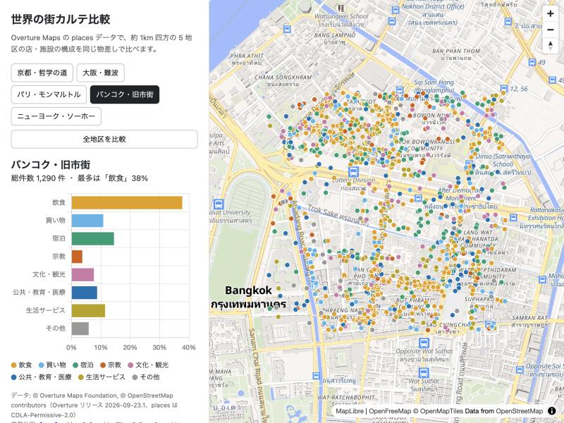

# 世界の街カルテ比較

Overture Maps の places データを使い、世界 5 地区（各約 1km 四方）の店・施設の構成を同じ物差しで比べる Web 地図です。

- 地図：https://akira-motoyoshi.github.io/town-karte/
- 制作記：https://akira-motoyoshi.github.io/town-karte/article/



## なぜ Overture Maps か

Overture Maps は世界共通のスキーマとカテゴリ体系（`taxonomy.hierarchy`）を持つため、国が違っても同じ SQL・同じ分類で比較できます。データは S3 上の GeoParquet として公開されており、DuckDB から登録なし・無料で必要な範囲だけ読み出せます。

## 分かったこと

いずれも登録施設の構成比であり、実際の店舗数や活動量そのものではありません。

- 難波は飲食が 57% で、酒類を出す店が 666 件ありました。
- バンコク旧市街は宿泊が 14% で、他地区の 3 倍以上でした。
- ソーホーは生活サービスが 48% でした。
- 大豊神社が `christian_place_of_worship` に分類されていました。世界共通の分類が地域の文化を捉え損ねる例です。

## 対象地区

| id | 地区 | 中心（緯度, 経度） |
| --- | --- | --- |
| kyoto_tetsugaku | 京都・哲学の道 | 35.0215, 135.7955 |
| osaka_namba | 大阪・難波 | 34.6655, 135.5010 |
| paris_montmartre | パリ・モンマルトル | 48.8867, 2.3431 |
| bangkok_oldtown | バンコク・旧市街 | 13.7563, 100.4989 |
| nyc_soho | ニューヨーク・ソーホー | 40.7233, -74.0030 |

範囲は `areas.json` にあります。

## 分類の方法

`taxonomy.hierarchy` の 1 段目（一部は 2 段目）を 8 つの大分類にまとめています（`data/category_map.json`）。

- 飲食 / 買い物 / 宿泊 / 宗教 / 文化・観光 / 公共・教育・医療 / 生活サービス / その他
- 「宗教」は `cultural_and_historic` のうち `place_of_worship` と `religious_organization`
- 2 段目を優先する例外は宗教以外にもあります。例えば `travel_service` は文化・観光、`spiritual_advising` は生活サービスに分類します。対応の実物は `data/category_map.json` にあります。
- 「生活サービス」には `services_and_business`（士業、オフィス、不動産など）も含みます

## 抽出条件

各施設の bbox の左下隅（`bbox.xmin` と `bbox.ymin`）が地区範囲内にあるものを取得します。あわせて `confidence >= 0.6` の条件で、信頼度の低いデータを落としています。

## 再現手順

### A. 同梱データから再現する（通常はこちら）

同梱の `data/raw/` を使うため、S3 に依存しません。

```bash
python3 -m venv .venv
.venv/bin/pip install duckdb
.venv/bin/python scripts/build.py
python3 -m http.server 8000 --directory docs
```

ブラウザで http://localhost:8000 を開きます。

### B. 元データを再取得する

指定したリリースが S3 に残っていることが前提です。既存のデータを再取得するには `--force` を付けます。

```bash
.venv/bin/python scripts/fetch.py --release 2026-09-23.1 --force
.venv/bin/python scripts/build.py
python3 -m http.server 8000 --directory docs
```

古いリリースは S3 から削除されるため、取得済みデータ（`data/raw/`）もリポジトリに含めています。

## 使用したデータとライセンス

- **Overture Maps Foundation** places テーマ、リリース `2026-09-23.1`（CDLA-Permissive-2.0）。© Overture Maps Foundation, © OpenStreetMap contributors。各レコードの出典は `sources` 列を参照してください。
- 背景地図：[OpenFreeMap](https://openfreemap.org)（© OpenMapTiles © OpenStreetMap contributors）
- ライブラリ：MapLibre GL JS 4.7.1、Chart.js 4.4.1、DuckDB

Overture の places は OSM とライセンスが異なるため、このデータを OSM へ転記しないでください。

## 構成

```
areas.json              対象地区
scripts/fetch.py        Overture から取得
scripts/build.py        大分類に集計し公開用ファイルを出力
data/category_map.json  分類の対応表と色
data/raw/               取得結果（parquet）
docs/                   公開用（GitHub Pages）
docs/data/places/     地区ごとの施設データ（選んだ地区だけ読み込む）
docs/lt_outline.md      考察と LT 構成案
```
